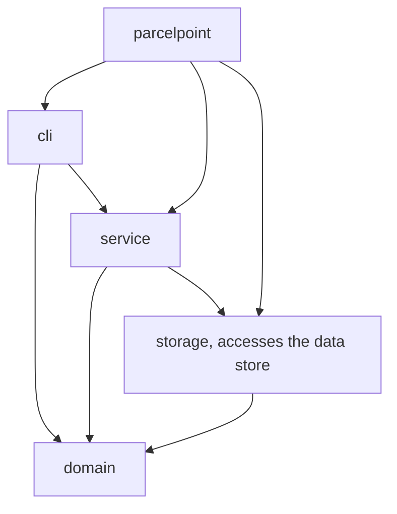
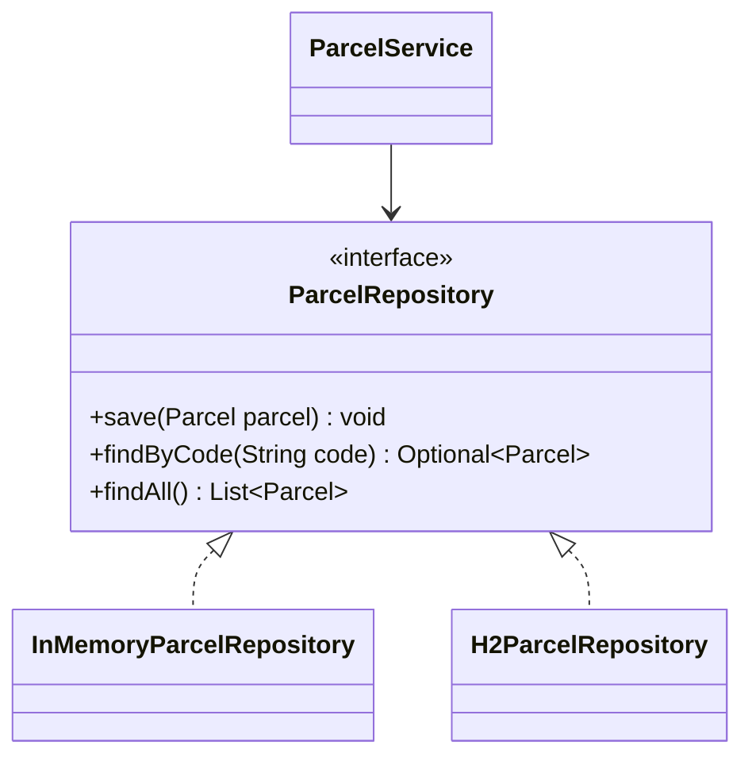
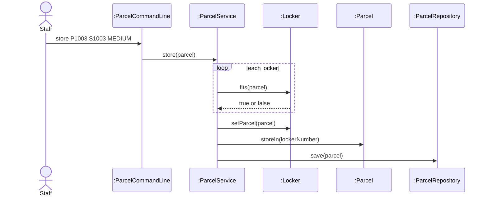

# Lab Report, Designing the Data Management Layer with H2

Repository URL: https://github.com/View1310/itcs382-h2-lab

## Tools

| Item | Version or name |
| --- | --- |
| JDK | OpenJDK 25.0.5-ea |
| Maven | Apache Maven 3.9.12 |
| IDE | Visual Studio Code 1.132.0 |
| AI tool and exact model, if you used one | ChatGPT, GPT-5.6 Sol |

## Part 0. From a store in memory to H2

Commit of the starter, before any change: 1ce9e03

0.3 Your prediction for `staff`, written before the second run: I predict that the parcels will be gone and all three lockers will be free because the parcels are currently stored only in memory.

Output of the second run, for `staff` and `quit`:

```text id="nK2u89"
> staff
Free lockers: 3
> quit
```

State in one sentence where you think the parcels of the first run were kept.

The parcels were kept in the memory of the running program, so they disappeared when the program ended.

0.5 The line of Main that you would change to keep the parcels somewhere else:

```java id="Z9d2qK"
ParcelRepository repository = new InMemoryParcelRepository();
```

0.6 Commit of the switch to H2: bbc1327

0.7 Output of `SELECT * FROM PARCEL;` after you stored two parcels:

```text id="uU5w2p"
sql> SELECT * FROM PARCEL;
CODE  | STUDENT_ID | PARCEL_SIZE | STATUS | LOCKER_NUMBER
P1001 | S1001      | SMALL       | STORED | 1
P1002 | S1002      | LARGE       | STORED | 3
(2 rows, 20 ms)
```

0.8 Explain why ParcelPoint could not start while the H2 Shell was open, and identify the class that wrote the message `Cannot create the PARCEL table`.

**Ans** ParcelPoint could not start because the H2 Shell was still using the database, so the database file was locked and ParcelPoint could not open it at the same time. The `H2ParcelRepository` class wrote the message `Cannot create the PARCEL table`.

0.9 Explain why `staff` shows no parcel while `find` shows each one, and why all three lockers look free.

**Ans** `find` can show the parcels because `findByCode` reads them from the H2 database. However, `staff` uses `findAll`, which currently returns an empty list instead of reading the parcels from H2. `ParcelService` also uses `findAll` when it starts to restore stored parcels to their lockers, so no parcels are restored and all three lockers appear free.

0.11 Your findAll method:

```java id="8Pj3aL"
@Override
public List<Parcel> findAll() {
    String sql = "SELECT * FROM PARCEL ORDER BY CODE";
    List<Parcel> parcels = new ArrayList<>();

    try (Connection connection = connect();
            PreparedStatement statement = connection.prepareStatement(sql)) {
        try (ResultSet row = statement.executeQuery()) {
            while (row.next()) {
                parcels.add(toParcel(row));
            }
        }
    } catch (SQLException e) {
        throw new IllegalStateException("Cannot read the parcels", e);
    }

    return parcels;
}
```

Commit that adds findAll: 698fced

0.12 Output of `SELECT * FROM PARCEL;` after the pickup:

```text id="j4mA7q"
sql> SELECT * FROM PARCEL;
CODE  | STUDENT_ID | PARCEL_SIZE | STATUS    | LOCKER_NUMBER
P1001 | S1001      | SMALL       | PICKED_UP | null
P1002 | S1002      | LARGE       | STORED    | 3
(2 rows, 16 ms)
```

0.13 Optional. Describe what `find P9999'OR'1'='1` showed while the SQL was joined from strings, and what it showed after you put the placeholder back.

**Ans** When the SQL was joined from strings, `find P9999'OR'1'='1` returned P1001 even though that parcel code does not exist. After I restored the placeholder and `setString`, the same command returned `No parcel with code P9999'OR'1'='1` because the input was treated as one value instead of part of the SQL statement.

## Part A. Model the design

A1 Complete the flowchart with one node for each package and one arrow for each dependency, from the package that uses to the package that is used. Mark the package that accesses the data store.



State whether cli depends on storage, and explain why.

**Ans** No, `cli` does not depend on `storage`. `ParcelCommandLine` uses classes from `domain` and `ParcelService` from `service`, but it does not directly import or use any class from `storage`.

A2 Complete the class diagram of the data management layer with ParcelService, the interface ParcelRepository with its three operations, and the two classes that implement it.



A3 Draw a sequence diagram for the command `store P1003 S1003 MEDIUM`, from the staff member to the repository. Show each message as an operation of the class that receives it.



Explain why the last lifeline is the interface ParcelRepository rather than H2ParcelRepository.

**Ans** `ParcelRepository` is the last lifeline because `ParcelService` depends on the `ParcelRepository` interface and does not directly know about `H2ParcelRepository`. This keeps the service independent from the specific data store implementation.

## Part B. Design questions

1. Identify the files that you changed to move from the store in memory to H2, and explain why no other class had to change. Use the terms of this course.

**Ans** I changed `Main.java` to replace `InMemoryParcelRepository` with `H2ParcelRepository`. No other class needed to change because `ParcelService` depends on the `ParcelRepository` interface instead of a specific repository implementation. This follows the Dependency Inversion Principle and keeps the business layer independent from the data store.

2. The PARCEL table stores the size of a parcel as SMALL, MEDIUM or LARGE rather than as 1, 2 or 3. Identify the type of connascence between ParcelSize and the table in each case, and explain which one is weaker.

**Ans** Storing `SMALL`, `MEDIUM`, and `LARGE` creates connascence of name because the database values must match the names in `ParcelSize`. Storing them as `1`, `2`, and `3` would create connascence of convention because both sides must agree on what each number represents. Connascence of name is weaker because the relationship is clearer and easier to understand.

3. Project Phase 2 asks for a data store that needs no separate server. Explain why an embedded database such as H2 meets this rule, and describe the limit of an embedded database that Step 0.8 showed.

**Ans** H2 meets the requirement because it runs inside the program as an embedded database, so it does not need a separate database server. However, Step 0.8 showed that only one program can use the embedded database file at a time. When the H2 Shell had the database open, ParcelPoint could not access it because the file was locked.

4. State the data store that you would choose for your Project Phase 2 team, files or an embedded database, the requirement that drives the choice, and the package that will access it.

**Ans** I would choose an embedded database such as H2 because our Gemini system needs to store structured data such as science plans and observing programs, and the data must remain available after the program ends. H2 also meets the requirement that the data store does not need a separate server. The data management package containing the repository classes will access the database.

## AI usage declaration

| AI tool and exact model | Date | Purpose | Files or answers it produced or changed | How you checked its output |
| --- | --- | --- | --- | --- |
| ChatGPT, GPT-5.6 Sol | 14 November 2026 | Guided me through the lab and helped explain the concepts and instructions. | `LAB_REPORT.md` and `H2ParcelRepository.java` | I checked the guidance against the lab instructions and source code, ran the commands myself, tested the program, checked the H2 database, and verified the Mermaid diagrams. |